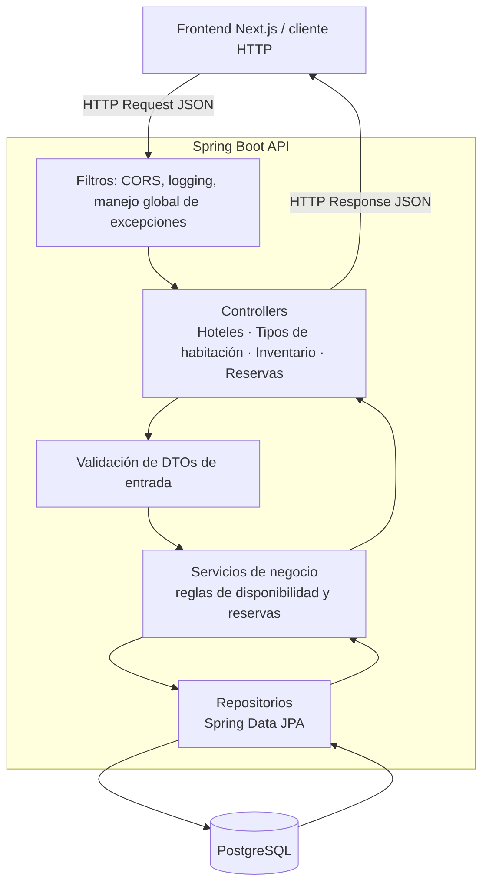
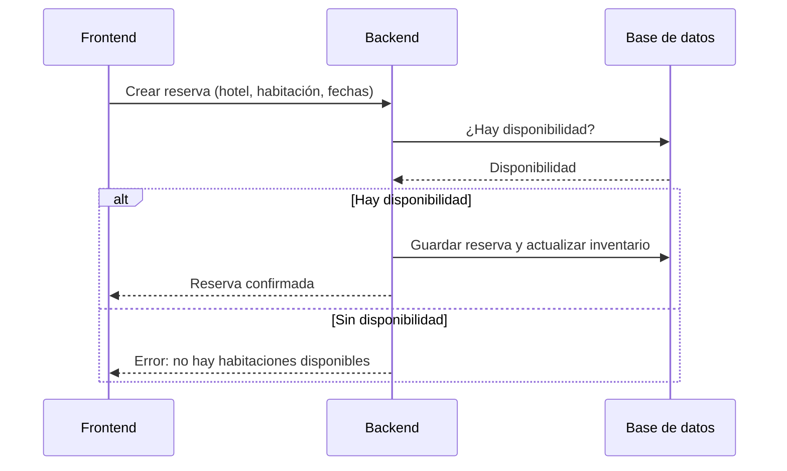

# Flujo del Backend

API en Java 21 (Spring Boot) organizada en capas: controllers, validación, servicios de negocio y repositorios sobre Spring Data JPA.

## Arquitectura por capas

## Flujo detallado: alta de una reserva

Antes de confirmar una reserva, el backend comprueba que haya disponibilidad para las fechas solicitadas y, si la hay, descuenta el inventario correspondiente.

## Responsabilidades por capa

- **Controllers**: exponen los endpoints REST por módulo (hoteles, tipos de habitación, inventario, reservas) y traducen peticiones/respuestas HTTP.
- **Validación**: comprueba la integridad de los datos de entrada antes de llegar a la lógica de negocio.
- **Servicios**: contienen las reglas de negocio (p. ej. comprobación de disponibilidad antes de confirmar una reserva, cálculo de estado de la operativa).
- **Repositorios**: acceso a datos vía Spring Data JPA (Hibernate), aislando al resto de capas del detalle de persistencia.
