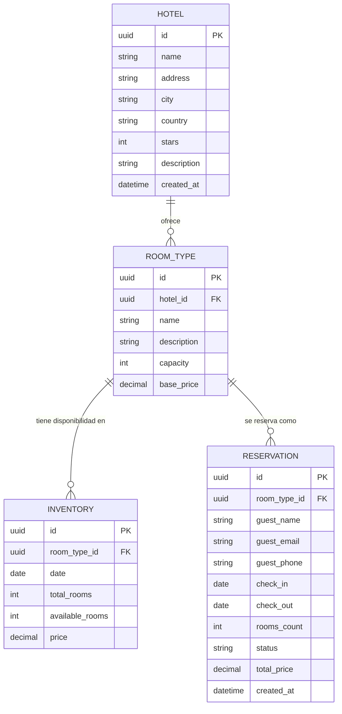

# Diagrama Entidad-Relación

Modelo de datos del backoffice: un hotel ofrece distintos tipos de habitación, cada tipo de habitación tiene inventario (disponibilidad) a lo largo del tiempo, y las reservas se registran sobre un tipo de habitación de un hotel concreto.

## Descripción de entidades

- **HOTEL**: datos principales del hotel (nombre, ubicación, categoría). Es la raíz del catálogo.
- **ROOM_TYPE**: tipos de habitación asociados a un hotel (p. ej. doble, suite), con capacidad y precio base.
- **INVENTORY**: disponibilidad de un tipo de habitación para una fecha concreta (habitaciones totales, disponibles y precio del día). Un registro por tipo de habitación y fecha.
- **RESERVATION**: reserva de un tipo de habitación para un rango de fechas, con los datos del cliente, número de habitaciones, estado (pendiente, confirmada, cancelada) e importe total.

## Notas de diseño

- El hotel se obtiene de forma indirecta a través del tipo de habitación (`ROOM_TYPE.hotel_id`), evitando duplicar la referencia al hotel en inventario y reservas.
- El estado de la reserva (`status`) permite construir el panel operativo de actividad diaria sin necesidad de tablas adicionales en el MVP.
- La granularidad diaria del inventario simplifica tanto la carga de disponibilidad como las vistas de calendario/tabla solicitadas por el cliente.
