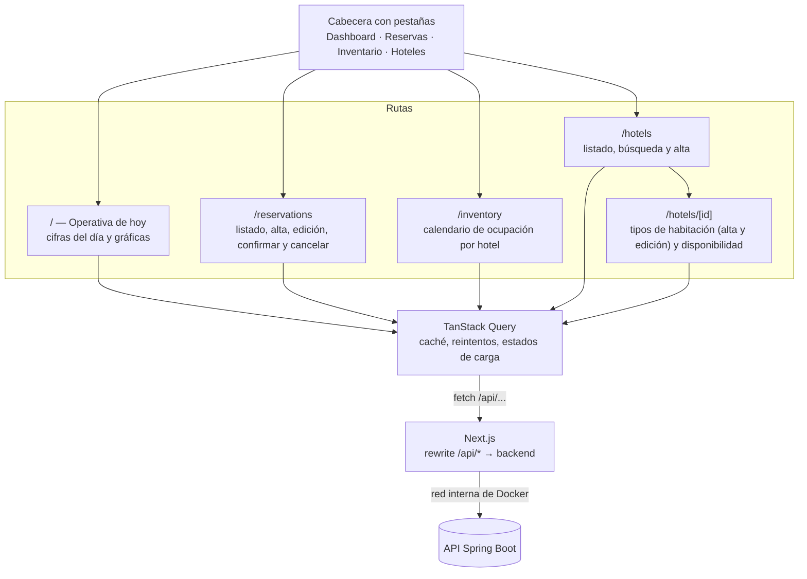
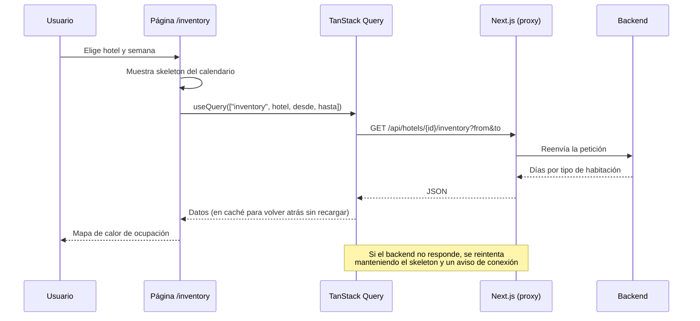

# Flujo del Frontend

Aplicación Next.js 16 (App Router, React 19 + TypeScript) organizada por módulos funcionales. El navegador solo habla con Next.js, que reenvía `/api/*` al backend.

## Navegación y módulos

## Flujo de datos de una vista (ejemplo: Inventario)

## Principios de diseño

- **Por módulo**: `src/features/<módulo>` agrupa las vistas y formularios de cada área; `src/app` solo define las rutas.
- **Carga previa visible**: cada página tiene un esqueleto completo como fallback de `Suspense` y cada bloque su propio skeleton mientras llegan los datos.
- **Lectura rápida**: la portada resume el día en una franja de cifras (ocupación, entradas, salidas, estancias activas) y gráficas de evolución.
- **Errores comprensibles**: los fallos de negocio del backend (p. ej. sin disponibilidad) se muestran dentro del formulario o en diálogos nativos; los fallos transitorios se reintentan solos.
- **Volumen elevado**: los listados paginan y filtran en el servidor; el buscador de hoteles sugiere resultados mientras se escribe.
