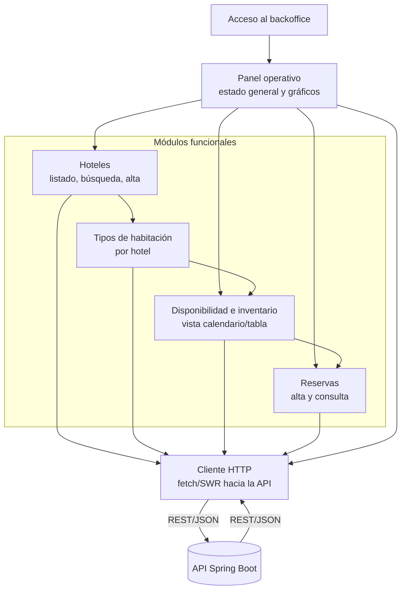
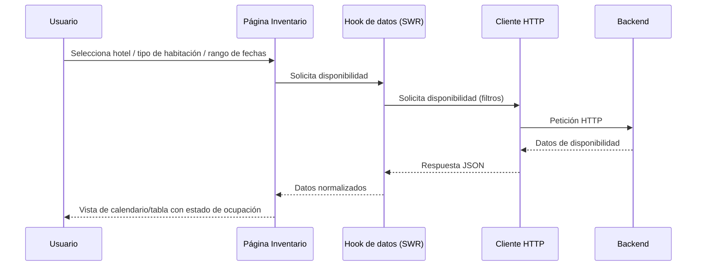

# Flujo del Frontend

Aplicación Next.js (React + TypeScript) organizada por módulos funcionales, cada uno consumiendo la API del backend a través de un cliente HTTP compartido.

## Navegación y módulos

## Flujo de datos de una vista (ejemplo: Inventario)

## Principios de diseño

- **Por módulo**: cada módulo funcional (hoteles, tipos de habitación, inventario, reservas) tiene sus propias páginas, componentes y llamadas a la API.
- **Panel operativo**: página de inicio con indicadores y gráficos del estado general de la operativa (ocupación, reservas del día), pensada para la lectura rápida durante la operación diaria.
- **Capa de datos común**: un único cliente HTTP centraliza las llamadas al backend, facilitando el manejo de errores y la reutilización entre módulos.
- **Listados con búsqueda y paginación**: las vistas de hoteles e inventario soportan búsqueda y paginación para trabajar con volúmenes elevados de registros.
